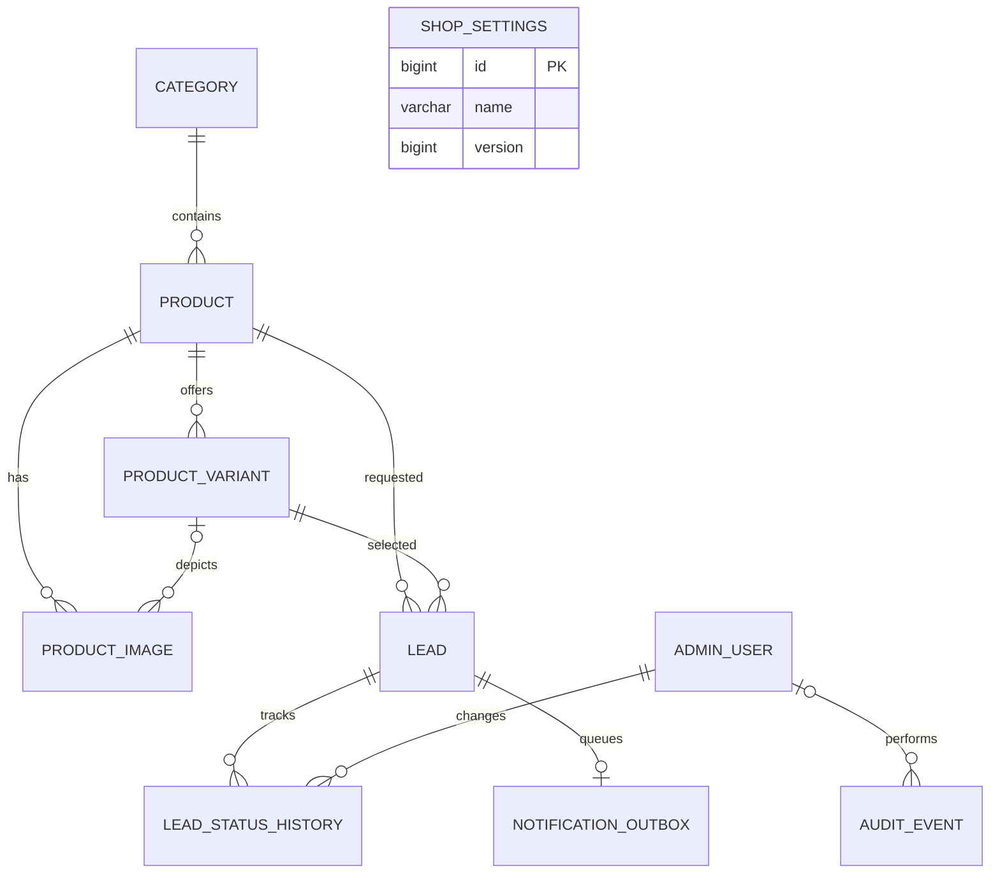

# Архитектура

Один origin обслуживает Vite-сборку и REST API. В производстве перед Spring Boot размещается CDN/WAF и reverse proxy. PostgreSQL и хранилище медиа закрыты от прямого доступа. Spring Boot модульный монолит. Java-пакеты catalog, leads, identity и common отвечают за каталог/настройки/медиа, заявки/outbox, учётные записи/сессии и ошибки/аудит/лимиты.

- Spring Data JPA и @Version контролируют изменения настроек, каталога и учётных записей. DTO отделены от сущностей.
- PostgreSQL выбирает по одной подходящей комплектации на модель. Параметры цены применяются до группировки. Вычисление действующей скидки использует полуоткрытый интервал UTC. Поиск использует Unicode collation PostgreSQL 18 для сопоставления регистра и в базе с локалью C.
- Заявка сериализуется по ключу повторной отправки. Транзакция повторно проверяет состояние каталога и цену, сохраняет снимок и условную запись outbox.
- Отправитель берёт одну запись за раз с SKIP LOCKED и ограниченной арендой. Внешний HTTP выполняется после транзакции захвата. Токен аренды защищает фиксацию результата от опоздавшего обработчика.
- Spring Security хранит сессию на сервере. React получает токен CSRF перед изменением. Отзыв сессии проверяется по версии авторизации пользователя.
- Каталог и контакты читаются из БД. На этапе локальной реализации динамические ответы не кешируются на CDN. Скрытие действует при новом чтении.

## ERD

Бренд хранится как строка модели. Характеристики, скидка и рассрочка хранятся в типизированных колонках комплектации. Ограничения и индексы описаны в V1. Снимок заявки фиксирует модель, SKU, выбранные параметры, цену, скидку и условия рассрочки.
